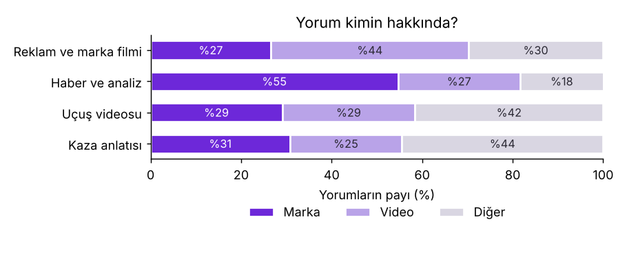
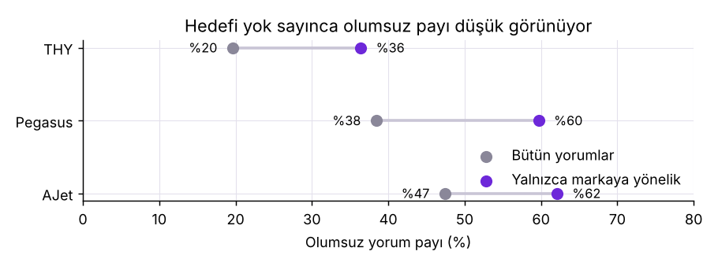
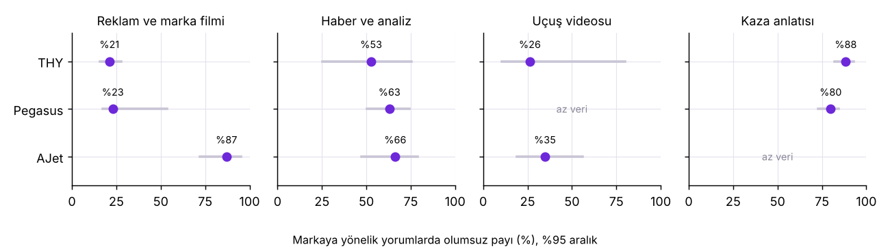

# Bir YouTube Yorumu Kimin Hakkında? Havayolu Videolarında Hedefli Duygu Analizi

THY, Pegasus ve AJet ile ilgili YouTube videolarının altındaki 6.659 Türkçe yorum üç etiketle
etiketlendi: **duygu** (olumlu, olumsuz, nötr), **hedef** (marka, video, diğer) ve **konu**.
Soru: yorumun kimin hakkında olduğuna bakmak sonucu ne kadar değiştiriyor?

**Rapor:** https://ozgurnurettinozturk.com/havayolu-sentiment-analizi

## Öne çıkanlar

- **Yorumların yalnızca %33'ü markayla ilgili.** %35'i videonun kendisini (reklam, müzik, anlatıcı),
  %32'si başka şeyleri konuşuyor.
- **Hedef yok sayılınca marka olduğundan olumlu görünüyor.** Olumsuz payı THY'de %20 yerine %36,
  Pegasus'ta %38 yerine %60, AJet'te %47 yerine %62.
- **Sonucu markadan çok video türü belirliyor.** Markaya yönelik yorumlarda olumsuz payı reklam
  filmlerinin altında %26, kaza anlatılarının altında %83.
- **THY ile Pegasus arasındaki ham fark (23 puan) büyük ölçüde örneklemden geliyor.** Pegasus'un oranları
  THY'nin video türü karışımına göre ağırlıklandırılınca %60 değil %39 (aralık 34–59); THY aynı türlerde %37.
- **Küçük bir model yorum düzeyinde yetmiyor, toplamda yetiyor.** TF-IDF + lojistik regresyon, dil modeli
  etiketleriyle yorumların %71'inde aynı kararı veriyor; marka düzeyindeki olumsuz payını ise 1–5 puan
  farkla tutturuyor.





## Yöntem

1. **Toplama (`01_yorum_topla.py`):** Her marka için aynı beş nötr arama; başlığında markanın adı geçen
   videolar; video başına en yeni 300 yorum. Yazar adı alınmaz.
2. **Hazırlık (`02_hazirla.py`):** Tekrarlar, Türkçe olmayan yorumlar (lingua ile), markayla ilgisiz videolar
   ve yanıtlar çıkarılır. 13.151 yorumdan 6.659'u kalır. Videolar başlıklarına göre elle dört türe ayrıldı
   (`video_turleri.csv`): reklam ve marka filmi, haber ve analiz, uçuş videosu, kaza anlatısı.
3. **Etiketleme:** Etiketleri bir dil modeli (Claude) verdi; her yorumu videonun başlığı ve türüyle birlikte
   okudu, `etiket/KILAVUZ.md` içindeki kılavuza göre karar verdi. Rastgele 400 yorum ayrı bir geçişte
   yeniden etiketlendi.
4. **Analiz (`03_analiz.py`):** Oranlar, video bazında yeniden örneklemeyle (bootstrap) %95 aralıklar,
   video türü karışımına göre standardizasyon, konular ve hafif sınıflandırıcı denemesi
   (çapraz doğrulamada katlar videoya göre ayrılır).

| Etiket | İki geçişin uyumu | Cohen kappa |
|---|---|---|
| Duygu | %96,5 | 0,95 |
| Hedef | %95,5 | 0,93 |
| Konu | %96,5 | 0,93 |

Bu tutarlılık ölçüsüdür, doğruluk değil: iki geçiş de aynı modelden geliyor ve etiketler insan etiketiyle
karşılaştırılmadı.

## Depodakiler

| Dosya | İçerik |
|---|---|
| `01_yorum_topla.py`, `02_hazirla.py`, `03_analiz.py` | Toplama, hazırlık, analiz |
| `video_turleri.csv` | 115 videonun türü |
| `etiket/KILAVUZ.md` | Etiketleme kılavuzu |
| `etiket/etiketler.csv` | Yorum kimliği başına duygu, hedef, konu; 400 yorumda ikinci geçiş |
| `outputs/` | `summary.json`, `hazirlik.json` ve grafikler |

Yorum metinleri depoda yok. Etiketler YouTube yorum kimliğiyle tutulur.

## Çalıştırma

```bash
pip install -r requirements.txt
python 01_yorum_topla.py     # data/youtube_yorumlar.csv, data/videolar.csv
python 02_hazirla.py         # data/analiz_kumesi.csv, etiket/girdi/*.txt
python 03_analiz.py          # outputs/summary.json ve grafikler
```

Yeniden toplanan veri farklı olur: arama sonuçları ve yorumlar zamanla değişir. `03_analiz.py` yalnızca
`etiket/etiketler.csv` içinde etiketi olan yorumlarla çalışır.

## Sınırlar

- Örneklemi YouTube'un arama sıralaması belirledi; başka aramalar başka oranlar verir.
- Yorum yazanların o havayoluyla uçup uçmadığı bilinmiyor. Oranlar hizmet kalitesi ölçüsü değildir.
- Etiketler dil modelinden; insan etiketiyle doğrulanmadı.
- Video türleri tek kişi tarafından, başlığa bakılarak atandı.
- Marka ve tür kırılımında hücre başına 4–21 video var; aralıklar geniş.
